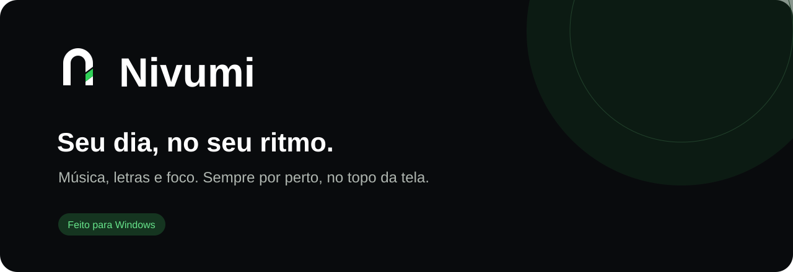
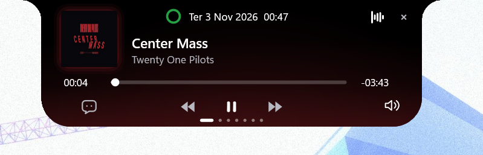
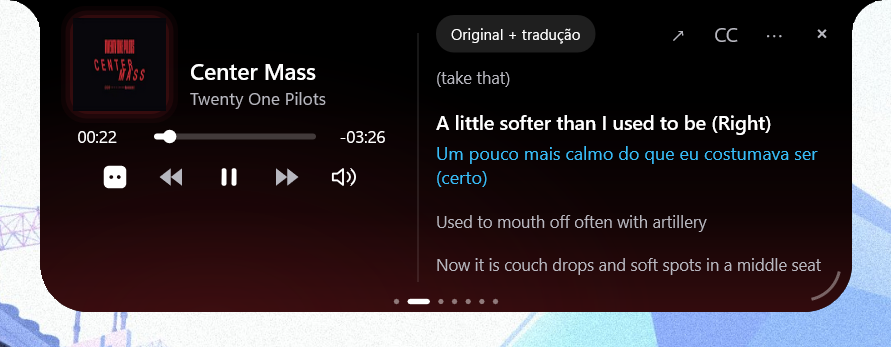
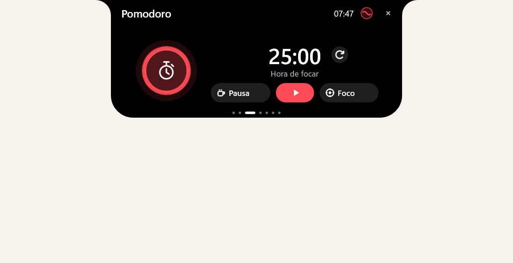
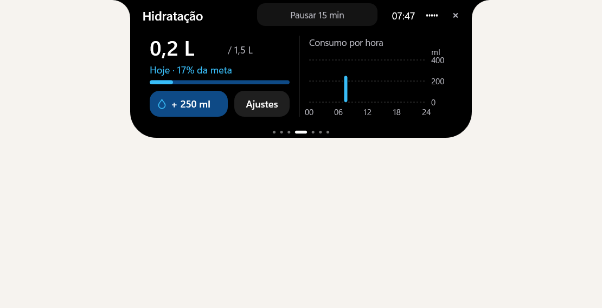
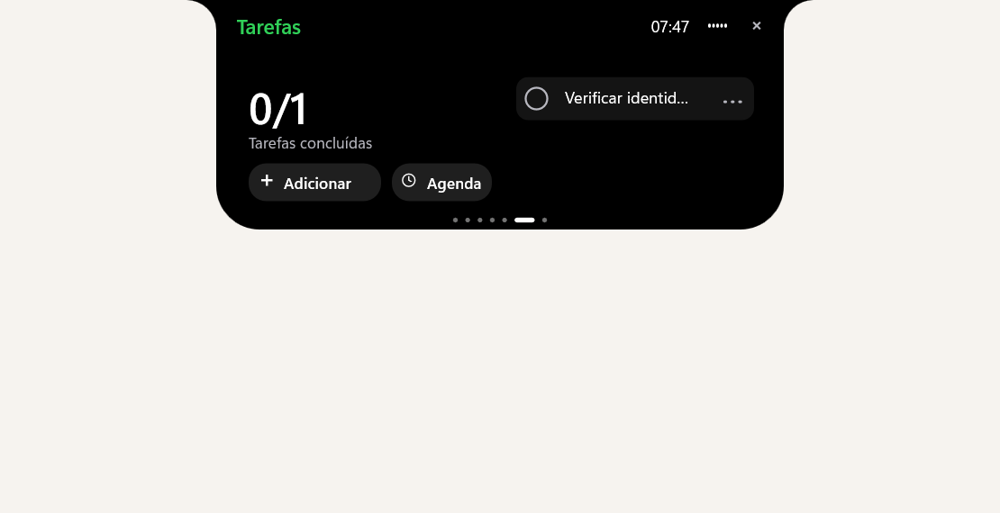

<div align="center">
  

  <br><br>

  **Um pequeno espaço para sua música e sua rotina.**

  Um painel nativo para Windows que reúne o que você quer ter por perto — sem ocupar sua mesa.

  [Conhecer](#seu-dia-em-um-painel) · [Instalar](#comece-por-aqui) · [Desenvolver](#feito-com-rust) · [Documentação](#por-dentro-do-projeto)

  
  
  
</div>

<br>

## Sua música, mais perto

Controle a reprodução, acompanhe a letra e leia a tradução sem trocar de janela. O fundo acompanha as cores da capa; o painel recolhe quando você precisa de espaço.

### Tela inicial · player

<p align="center">
  
</p>

### Letras e tradução

<p align="center">
  
</p>

<sub>Player e letras: capturas reais do aplicativo enviadas pelo usuário. As imagens de foco, hidratação e tarefas abaixo usam dados de demonstração.</sub>

## Seu dia em um painel

<table>
<tr>
<td width="50%" valign="top">

### Tempo para focar

Pomodoro com ciclos de foco, pausas e alarmes. Uma coisa de cada vez.



</td>
<td width="50%" valign="top">

### Uma pausa para você

Registre sua água, acompanhe a meta diária e veja o consumo ao longo do dia.



</td>
</tr>
<tr>
<td width="50%" valign="top">

### Menos coisas na cabeça

Tarefas, lembretes e calendário, acessíveis no mesmo lugar.



</td>
<td width="50%" valign="top">

### Um lugar para guardar

A Prateleira recebe arquivos e imagens de capturas de tela. Arraste arquivos para dentro ou cole uma captura com **Ctrl + V**; depois, selecione e leve para outro aplicativo.

**Também por perto**

- Letras em leitor separado ou legenda flutuante.
- Tradução offline opcional de inglês para português brasileiro.
- Extensão **Nivumi Lyrics Bridge** para trazer letras do navegador.
- Ícones próprios no Windows e modo portátil.

</td>
</tr>
</table>

## Comece por aqui

### Com instalador

Use o arquivo **`NivumiSetup.exe`** gerado em `dist/`. A instalação é por usuário e não exige administrador.

1. Execute o instalador e escolha a pasta.
2. Mantenha marcada a opção de atalho na Área de Trabalho, se desejar.
3. Ao concluir, você pode abrir o atalho para **fixá-lo na barra de tarefas** pelo menu do botão direito.

A fixação na barra de tarefas exige uma ação sua. A inicialização com Windows pode ser ativada nas configurações do app; começa desativada.

### Sem instalar

Extraia **`Nivumi-Portable.zip`** em uma pasta com permissão de escrita e abra **`nivumi.exe`**. O marcador `portable.flag` mantém os dados na pasta `data` ao lado do executável.

> Os pacotes são gerados localmente. Este README não aponta para uma release pública ainda.

## A letra no tempo certo

O ajuste é salvo **por música** e compartilhado entre painel, modo compacto, leitor separado e legenda flutuante.

| Atalho | Ação |
| --- | --- |
| **Ctrl + Alt + +** | Adiantar a letra em 0,1 segundo |
| **Ctrl + Alt + −** | Atrasar a letra em 0,1 segundo |
| **Ctrl + Alt + 0** | Zerar o ajuste da música atual |
| **Ctrl + V** com o painel em foco | Colar uma captura na Prateleira |

[Mais sobre sincronização](docs/lyrics-sync.md) · [Gestos e atalhos da Prateleira](docs/guide.md#prateleira)

## Feito com Rust

Interface nativa com Win32, Direct2D, DirectWrite, DirectComposition e Direct3D 11.

**Para compilar:** Windows, Rust com target `x86_64-pc-windows-msvc`, ferramentas C++ MSVC e Windows SDK.

```powershell
# Compilar e abrir em desenvolvimento
./scripts/run.ps1

# Formatação, Clippy e testes
./scripts/check.ps1

# Gerar executável e ZIP portátil
./scripts/build.ps1

# Gerar também o instalador (requer Inno Setup)
./scripts/build.ps1 -Installer
```

[Guia completo de desenvolvimento, distribuição e integrações](docs/guide.md)

## Seus dados

Configurações e estado ficam localmente em `%LOCALAPPDATA%\NusaRebuild`, caminho mantido para compatibilidade. A versão portátil usa sua própria pasta de dados. O override `NIVUMI_DATA_DIR` tem prioridade, com suporte ao alias legado `NUSA_REBUILD_DATA_DIR`.

A Prateleira guarda referências aos arquivos originais; remover uma referência não apaga o arquivo. Operações explícitas de mover ou recortar afetam o arquivo real. As buscas online de letras enviam metadados da faixa aos serviços consultados.

Atualizações preservam os dados existentes. A desinstalação interativa pergunta antes de removê-los; a silenciosa os mantém. Não há atualização automática nesta versão.

## Por dentro do projeto

| Para saber mais | Documento |
| --- | --- |
| Uso, configurações, integrações e build | [Guia do Nivumi](docs/guide.md) |
| Identidade, capturas e limites de validação | [Identidade Nivumi](docs/nivumi-branding.md) |
| Ajuste de letras por música | [Sincronização](docs/lyrics-sync.md) |
| Tradução local opcional | [Tradução offline](docs/offline-translation.md) |
| Estado e persistência | [Domínio](docs/domain.md) |
| Diálogos e instalação | [Diálogos](docs/dialogs.md) |


<br>

<div align="center">
  
  <br>
  <sub><strong>Nivumi</strong> · Seu dia, no seu ritmo.</sub>
</div>
